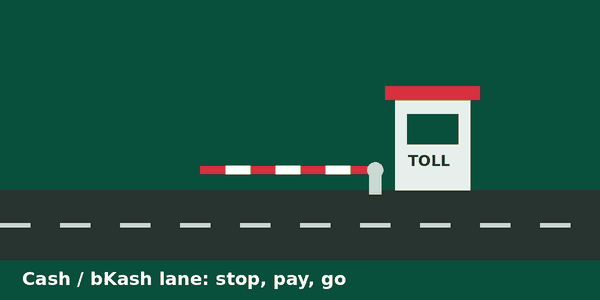
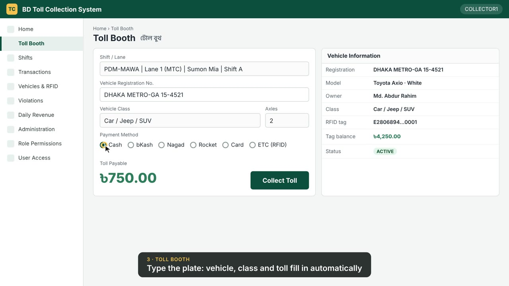
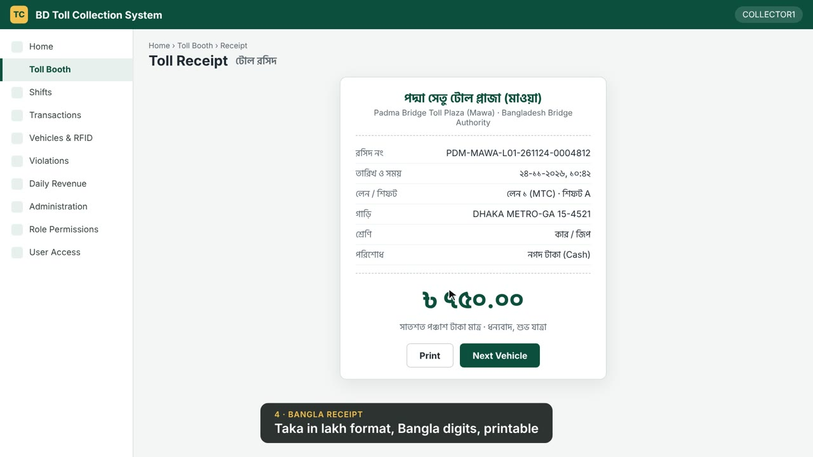
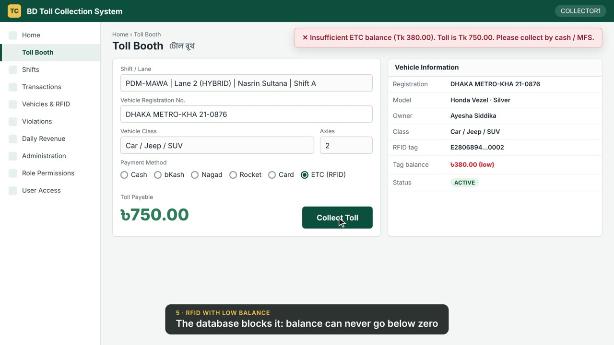
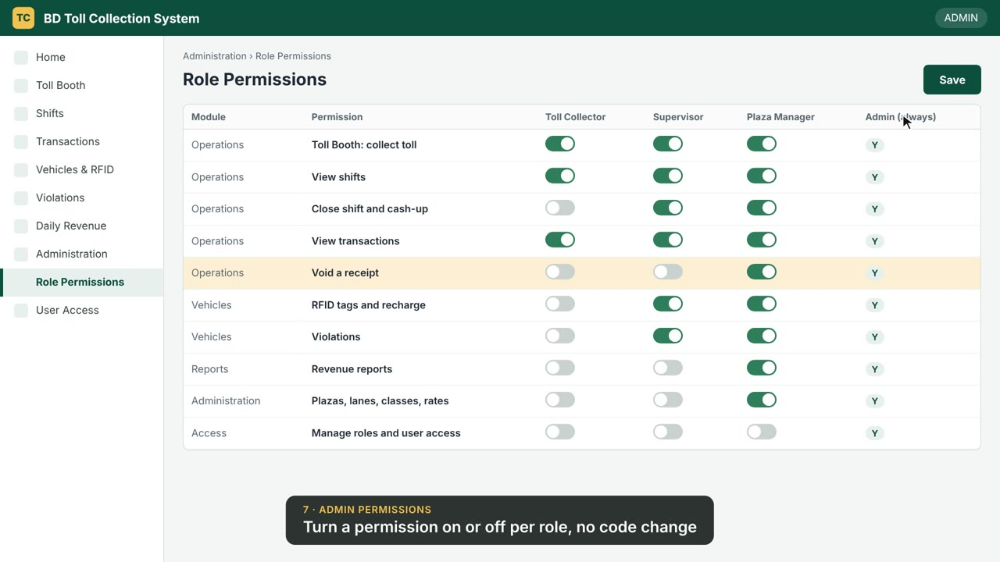
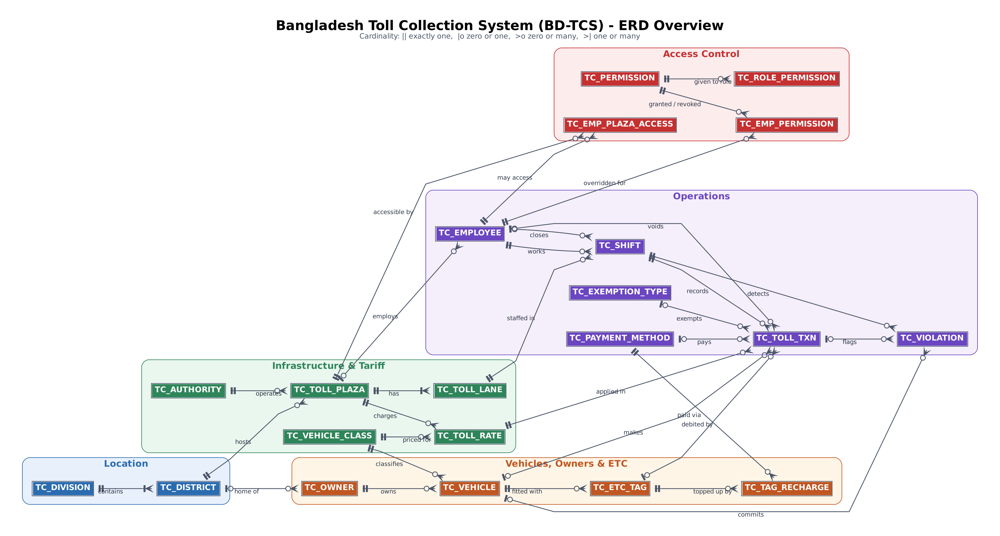
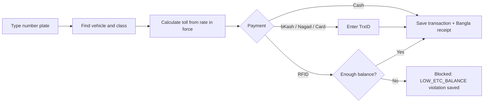
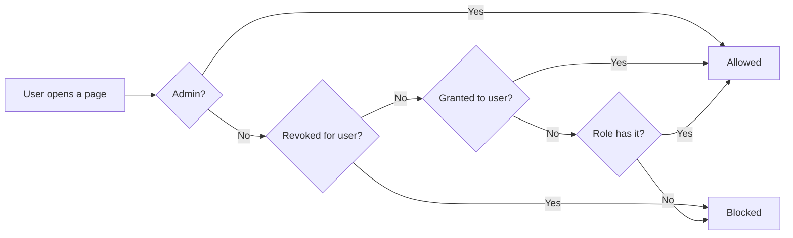

# BD-TCS: Toll Collection System for Bangladesh

A toll plaza management system built with **Oracle APEX** and **Oracle Database (PL/SQL)**, following Bangladesh standards: BRTA number plates, NID and mobile formats, Taka in lakh-crore format, bKash/Nagad/Rocket payments, RFID (ETC) lanes and Bangla receipts.

Built as a Database Management course project by **Noor-E-Arafin Rafi**.



▶️ **Preview video:** [media/bd-tcs-preview.mp4](media/bd-tcs-preview.mp4) (56 s walkthrough: sign in, dashboard, toll booth, Bangla receipt, RFID low balance, permissions, ERD)

---

## Highlights

| | |
|---|---|
| **5 toll plazas** | Padma Bridge (Mawa, Janjira), Jamuna Bridge, Karnaphuli Tunnel, Dhaka Elevated Expressway |
| **13 vehicle classes** | Motorcycle to 5+ axle trailer, with per-axle charges |
| **6 payment methods** | Cash, bKash, Nagad, Rocket, Card and RFID (ETC) |
| **4 roles** | Toll Collector, Supervisor, Plaza Manager, Admin |
| **Admin-configurable permissions** | 16 permissions per role, per-user GRANT/REVOKE, plaza-level data scope |
| **21 tables** | Third Normal Form, Crow's Foot ERD, 31 relationships |

## Screenshots

| Toll Booth | Bangla receipt |
|---|---|
|  |  |
| **RFID with low balance is blocked** | **Admin role permissions** |
|  |  |

## Database design



| Group | Tables |
|---|---|
| Location | `TC_DIVISION`, `TC_DISTRICT` |
| Plaza & tariff | `TC_AUTHORITY`, `TC_TOLL_PLAZA`, `TC_TOLL_LANE`, `TC_VEHICLE_CLASS`, `TC_TOLL_RATE` |
| Vehicles & RFID | `TC_OWNER`, `TC_VEHICLE`, `TC_ETC_TAG`, `TC_TAG_RECHARGE` |
| Operations | `TC_EMPLOYEE`, `TC_SHIFT`, **`TC_TOLL_TXN`**, `TC_VIOLATION`, `TC_PAYMENT_METHOD`, `TC_EXEMPTION_TYPE` |
| Access control | `TC_PERMISSION`, `TC_ROLE_PERMISSION`, `TC_EMP_PERMISSION`, `TC_EMP_PLAZA_ACCESS` |

The full ERD with every column is in [`erd/BD_TCS_ERD.png`](erd/BD_TCS_ERD.png) and the editable [`erd/BD_TCS_ERD.drawio`](erd/BD_TCS_ERD.drawio) (open in [diagrams.net](https://app.diagrams.net)).

**Normalization:** `TC_TOLL_TXN` stores no plaza, lane or class; they are reached through `shift → lane → plaza` and `rate → class`. Four associative entities (`TOLL_RATE`, `SHIFT`, `EMP_PERMISSION`, `EMP_PLAZA_ACCESS`) resolve many-to-many relationships. `toll_amount` and the shift cash totals are kept on purpose as historical snapshots.

### Rules enforced inside the database

| Rule | How |
|---|---|
| One open shift per lane and per employee | Function-based unique index |
| One active RFID tag per vehicle | Function-based unique index |
| A toll has a payment or an exemption, never both | CHECK constraint |
| RFID balance never goes below zero | CHECK constraint + `SELECT … FOR UPDATE` |
| A failed RFID payment is still recorded | Autonomous transaction logs a `LOW_ETC_BALANCE` violation |
| NID, mobile and plate follow Bangladesh formats | CHECK constraints with `REGEXP_LIKE` |
| Users see only their own plazas | Plaza-scoped views (`TC_V_MY_PLAZA`) |

## Workflows

**How one vehicle pays the toll**



**How the app decides a permission**



## Tech stack

- Oracle APEX 26 (apex.oracle.com) · Universal Theme
- Oracle Database 23ai · PL/SQL package `TC_TOLL_PKG` and `TC_ACCESS_PKG`
- Interactive Reports and Grids, Dynamic Actions, Authorization Schemes (checked once per page view)

## Install

1. Get a free workspace at [apex.oracle.com](https://apex.oracle.com).
2. **SQL Workshop → SQL Scripts → Upload** `database/BD_TCS_install_all.sql` and run it (or run `01` to `06` in order).
3. Build the application by following [`docs/APEX_Build_Guide.md`](docs/APEX_Build_Guide.md) (written in Bangla, PDF included) and [`docs/access-control-apex-steps.md`](docs/access-control-apex-steps.md).
4. Create APEX users and map them to employees: `COLLECTOR1`, `SUPERVISOR1`, `MANAGER1` (Administration → Employees → APEX Username).

`database/00_drop_all.sql` removes every `TC_` object if you want to start again.

## Repository layout

```
database/       SQL: tables, PL/SQL packages, views, seed data, access control
docs/           APEX build guide and access-control build steps
erd/            ERD in draw.io, PNG, SVG and PDF
media/          Preview video, screenshots and animations
presentation/   Project slides (PowerPoint)
```

## License

[MIT](LICENSE) © 2026 Noor-E-Arafin Rafi

> Toll rates are taken from public sources for demonstration and may not match current official rates. Names, plates and phone numbers in the seed data are fictional.
